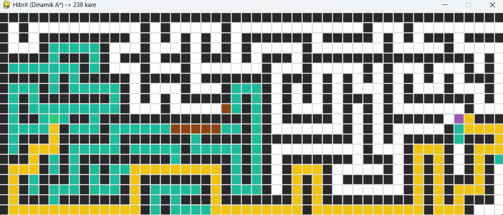
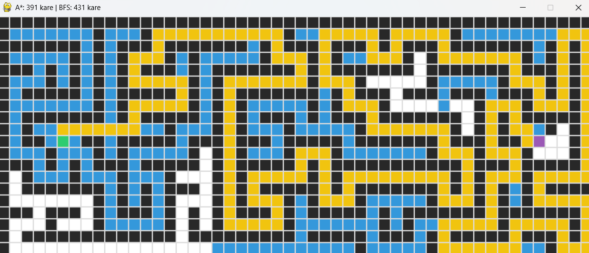

# labirent-yol-bulan-ajan
# Labirentte Yol Bulan Ajan (Hibrit BFS & A* Simülasyonu)

Bu proje, **20x50** boyutundaki dinamik bir ızgara (grid) üzerinde başlangıç ve hedef noktaları arasındaki en kısa yolu **BFS (Breadth-First Search)** ve **A* (A-Star)** algoritmalarını hibrit bir yapıda kullanarak bulan ve arama sürecini **Pygame** ile görselleştiren bir yapay zeka simülasyonudur.

## Özellikler
- **20x50 Etkileşimli Izgara:** Kullanıcı fare ile başlangıç/hedef noktalarını belirleyebilir, engel (duvar) örebilir veya `W` tuşu ile maliyetli zorlu arazi (çamur) ekleyebilir.
- **Hibrit Yol Bulma Modu (`H` Tuşu):** Haritada maliyetli arazi bulunmadığında hızlı **BFS** algoritmasını, zorlu arazi veya dinamik maliyet değişimi algılandığında ise maliyet duyarlı **A*** algoritmasını otomatik olarak devreye sokar.
- **Algoritma Karşılaştırması (Bonus):** Hem **BFS** hem de **A*** algoritmalarının hedefe ulaşırken taradığı toplam kare sayısını hesaplar ve pencere başlığında karşılaştırmalı olarak gösterir.

## Kurulum ve Çalıştırma
1. Gerekli kütüphaneyi yükleyin:
```bash
pip install pygame
```
Simülasyonu başlatın:

```Bash
python main.py
```
## Kontroller
- **Sol Tık:** Duvar (engel) ekle / Başlangıç-Hedef belirle
- **W + Sol Tık:** Maliyetli arazi (Çamur) ekle
- **Sağ Tık:** Hücreyi temizle
- **SPACE:** BFS algoritmasını çalıştır
- **A:** A* algoritmasını çalıştır
- **H:** Hibrit modu çalıştır
- **M:** Rastgele labirent oluştur
- **R:** Rastgele engeller dağıt
- **D:** Çapraz hareketi aç/kapat
- **T:** Duvarları koruyarak sadece yolu temizle
- **C:** Tüm ekranı sıfırla

## Sonuçlar ve Ekran Görüntüleri

### 1. Hibrit Algoritma (Dinamik Maliyetli Arazi Kaçınma)
Haritaya maliyetli engeller (çamur) eklendiğinde hibrit yapı otomatik olarak dinamik A* algoritmasını seçer ve en düşük maliyetli rotayı oluşturur:


### 2. BFS ve A* Performans Karşılaştırması
Aynı 20x50 labirent haritasında **A*** algoritması **391 kare** tarayarak hedefe ulaşırken, **BFS** algoritması **431 kare** taramıştır:


## Veri Seti
Bu projede harita, labirent yapısı ve engeller kullanıcı tarafından etkileşimli veya rastgele olarak dinamik şekilde üretildiği için harici bir veri seti kullanılmamıştır.
